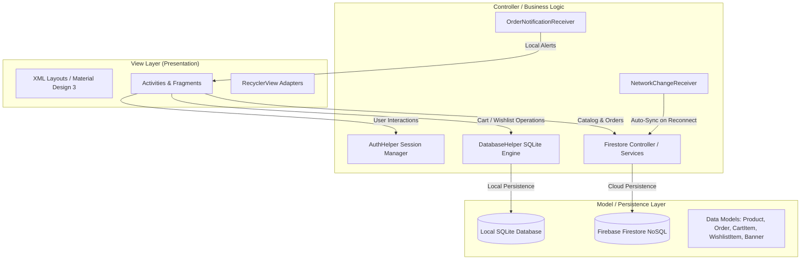

# FashionHub (EShop) — Native Android Luxury E-Commerce Application
### Comprehensive System Architecture, Codebase Reference & Viva Examination Guide

---

## 1. Executive Summary & Project Overview

**FashionHub (Vellora Edition)** is a production-grade, native Android mobile e-commerce platform developed using **Java** and the **Android SDK**. It delivers an ultra-refined, warm-luxury retail experience inspired by high-end boutique fashion interfaces, backed by a resilient, modern architectural foundation.

### Core Problems Solved:
1. **Uninterrupted Retail Experience (Offline-First Resilience)**: Consumers can browse products, manage their cart, and review their wishlist even when intermittent network connectivity drops. An intelligent background broadcast receiver automatically synchronizes local mutations with the cloud database when connectivity is restored.
2. **Precision Order Fulfillment & Location Geocoding**: Seamlessly maps physical delivery addresses using Google Maps SDK and forward/reverse geocoding, dynamically rendering route polylines from the flagship warehouse to the customer's doorstep.
3. **Transparent Order Tracking & Automated Telephony**: Dispatches cryptographically unique tracking codes directly to the customer's phone via native Android SMS services, supported by local broadcast notifications and in-app order lifecycle management.
4. **Interactive Merchandising**: Features dynamic product quantity calculation, real-time price updates, responsive multi-color swatch selection, and automated cart merging.

---

## 2. Technology Stack & Key Dependencies

| Layer / Concern | Technology / Library | Version / Specification | Architectural Purpose |
| :--- | :--- | :--- | :--- |
| **Language & Runtime** | Java (JDK 17) | Android API 24 - 34 (Android 7.0 to 14+) | Native application logic & system lifecycle |
| **User Interface** | XML & Material Design 3 | `com.google.android.material:material:1.11.0` | Custom Warm Luxury (Vellora) design language |
| **Cloud Database** | Firebase Cloud Firestore | `com.google.firebase:firebase-firestore:24.10.2` | Centralized NoSQL data storage (Products, Orders, Users, Banners) |
| **Local Database** | SQLite (`SQLiteOpenHelper`) | Native Android SQLite Engine | High-speed local caching for Cart, Wishlist, and Offline catalog |
| **Maps & Location** | Google Maps SDK & Android Geocoder | `com.google.android.gms:play-services-maps:18.2.0` | Map rendering, markers, route polylines, and geocoding |
| **Payment Gateway** | PayHere Android SDK | `lk.payhere:android-sdk:3.0.4` | Secure credit/debit card checkout gateway |
| **Image Loading** | Bumptech Glide | `com.github.bumptech.glide:glide:4.16.0` | Memory/disk caching, asynchronous image decoding |
| **Push Notifications** | OneSignal SDK & Firebase Cloud Messaging | `com.onesignal:OneSignal:4.8.6` & Firebase Messaging | Remote administrative alerts & promotional push notifications |
| **Native Hardware** | Android Telephony (`SmsManager`) & Telephony Intent | Android Framework API | Direct dispatch of order confirmation SMS and dialer inquiries |

---

## 3. System Architecture & Design Pattern

The application follows the **Model-View-Controller / Model-View-Adapter (MVC/MVA)** design pattern tailored for the Android platform:



### Architectural Pillars:
1. **Presentation Layer**: XML declarative layouts governed by AppCompat Activities and Fragments (`HomeFragment`), styled with Vellora theme tokens (`#F7F2E7` cream, `#1C1917` charcoal, `#BA770C` mustard amber).
2. **Controller Layer**: Coordinates business rules, validation, input events, hardware telephony, and asynchronous background tasks.
3. **Dual Persistence Layer**:
   - **Local SQLite Engine**: Immediate, zero-latency reads and writes for the Shopping Cart, Wishlist, and Cached Catalog items.
   - **Firebase Cloud Firestore**: Authoritative cloud store for User profiles, master Catalog products, Order transactions, and Live banners.

---

## 4. Comprehensive File Directory & Component Guide

### A. Core Activities & User Interfaces (`lk.prabhath.fashionhub.activity`)
* **`SplashActivity.java`**: Welcome / Onboarding gateway. Displays hero imagery, brand headline, and skip/get-started triggers with entrance animations.
* **`MainActivity.java`**: Application host container. Houses the `DrawerLayout`, luxury side navigation drawer (with user profile pic, email, VIP badge, theme toggle), and floating bottom capsule navigation dock (Home, Cart, Wishlist, Profile).
* **`HomeFragment.java`**: Primary product catalog dashboard. Contains the auto-scrolling promotional banner carousel (`ViewPager2`), real-time search filtering (`TextWatcher`), horizontal category selection pills, and the 2-column product grid.
* **`ProductDetailsActivity.java`**: Single product inspection screen. Instantly binds product data from Intent extras, manages interactive color swatches, drives the dynamic quantity counter, recalculates bottom-bar totals, handles store telephony/SMS inquiry, and executes "Add to Cart".
* **`CartActivity.java`**: Shopping cart screen. Displays SQLite cart items with item thumbnails, size/color chips, quantity increment/decrement controls, item deletion dialogs, order subtotal calculation, delivery fee rules, and navigation to Checkout.
* **`WishlistActivity.java`**: Saved favorites screen. Displays user-wishlisted items with direct "Add to Cart" and "Remove" operations.
* **`CheckoutActivity.java`**: Order finalization screen. Auto-fills user details from Firestore, renders interactive Google Maps with verified store markers and distance polyline, supports PayHere Card Gateway and Cash on Delivery (COD), generates unique `TRK-` tracking codes, dispatches confirmation SMS via `SmsManager`, and triggers order placement broadcasts.
* **`OrdersActivity.java`**: Customer order history screen. Queries Firestore for orders matching the logged-in email, showing Order ID, Tracking Code, status badges (Pending, Delivered, Cancelled), and order cancellation actions.
* **`ProfileActivity.java`**: Customer account management. Allows updating name, phone, address via Google Maps geocoding, and profile image selection.
* **`LoginActivity.java` & `RegisterActivity.java`**: Authentication workflows. Handles customer registration and login with session storage via `AuthHelper`.

### B. Adapters (`lk.prabhath.fashionhub.activity.adapter`)
* **`ProductAdapter.java`**: Binds products to the 2-column catalog grid. Features heart-icon wishlist toggling with micro-pulse animations and packs complete product data into Intent extras.
* **`CategoryAdapter.java`**: Manages horizontal category filter pills, toggling between active mustard-amber and inactive white styling.
* **`BannerAdapter.java`**: Renders promotional banner cards within `ViewPager2`.
* **`CartAdapter.java`**: Binds SQLite cart items, providing callbacks for quantity modification and deletion.
* **`OrderAdapter.java`**: Binds order cards with dynamic status color badges and tracking code chips.
* **`WishlistAdapter.java`**: Binds wishlist items with direct cart transfer and delete confirmation dialogs.

### C. Database, Receivers & Helpers (`lk.prabhath.fashionhub.activity.database`, `receiver`, `util`)
* **`DatabaseHelper.java`**: The SQLite database engine. Manages schema creation, migrations (`DATABASE_VERSION = 4`), cart duplicate checks, quantity incrementation, wishlist operations, and offline product caching.
* **`NetworkChangeReceiver.java`**: Background `BroadcastReceiver` that detects network state transitions (`CONNECTIVITY_CHANGE`) and syncs offline SQLite cart and wishlist data to Firestore.
* **`OrderNotificationReceiver.java`**: Custom `BroadcastReceiver` that captures `lk.prabhath.fashionhub.ORDER_PLACED` events and issues status bar push notifications containing the tracking code.
* **`AuthHelper.java`**: Encapsulates `SharedPreferences` session persistence (`is_logged_in`, `email`, `username`, `role`).
* **`AppNotificationHelper.java`**: Configures Android 8.0+ `NotificationChannel` instances for orders and offers.
* **`MyFirebaseMessagingService.java`**: Handles incoming Firebase Cloud Messaging payloads.

---

## 5. Database Schemas & Data Flow

### 1. Cloud Firestore (NoSQL Schema)
```
firestore
├── users (collection)
│   └── {userEmail} (document)
│       ├── name: string
│       ├── phone: string
│       ├── address: string
│       ├── imageUrl: string
│       ├── offlineCartSync: array of maps
│       └── offlineWishlistSync: array of maps
│
├── products (collection)
│   └── {productId} (document)
│       ├── productName: string
│       ├── price: number (double)
│       ├── imageUrl: string
│       ├── category: string
│       ├── description: string
│       ├── stock: number (int)
│       ├── rating: number (double)
│       └── reviewCount: number (int)
│
├── orders (collection)
│   └── {orderId} (document)
│       ├── orderId: string
│       ├── trackingCode: string (e.g., "TRK-A1B2C3D4")
│       ├── userEmail: string
│       ├── customerName: string
│       ├── customerPhone: string
│       ├── deliveryAddress: string
│       ├── paymentMethod: string ("PayHere" | "Cash on Delivery")
│       ├── totalAmount: number (double)
│       ├── status: string ("Pending" | "Delivered" | "Cancelled")
│       ├── timestamp: timestamp (server timestamp)
│       └── items: array of maps
│
└── banners (collection)
    └── {bannerId} (document)
        ├── imageUrl: string
        ├── title: string
        └── category: string
```

### 2. Local SQLite Engine (`DatabaseHelper`)
```sql
-- Table: cart
CREATE TABLE cart (
    id INTEGER PRIMARY KEY AUTOINCREMENT,
    product_id TEXT,
    name TEXT,
    price REAL,
    image TEXT,
    size TEXT,
    color TEXT DEFAULT 'Default',
    quantity INTEGER
);

-- Table: wishlist
CREATE TABLE wishlist (
    id INTEGER PRIMARY KEY AUTOINCREMENT,
    product_id TEXT,
    name TEXT,
    price REAL,
    image TEXT
);

-- Table: cached_products (Offline browsing)
CREATE TABLE cached_products (
    id INTEGER PRIMARY KEY AUTOINCREMENT,
    product_id TEXT UNIQUE,
    name TEXT,
    price REAL,
    image TEXT,
    category TEXT,
    description TEXT,
    rating REAL,
    review_count INTEGER,
    viewed_at INTEGER
);
```

---

## 6. Deep Dive into Core Technical Implementations

### A. Smart Cart Merging (No Duplicate Rows)
In [`DatabaseHelper.java`](file:///d:/AndroidStudioProjects/EShop/app/src/main/java/lk/prabhath/fashionhub/activity/database/DatabaseHelper.java):
```java
Cursor cursor = db.rawQuery("SELECT * FROM " + TABLE_CART + " WHERE " +
        COLUMN_PRODUCT_ID + "=? AND " + COLUMN_SIZE + "=? AND " + COLUMN_COLOR + "=?",
        new String[]{productId, size, color});

if (cursor != null && cursor.moveToFirst()) {
    int currentQty = cursor.getInt(cursor.getColumnIndexOrThrow(COLUMN_QUANTITY));
    int newQty = currentQty + qty;
    ContentValues values = new ContentValues();
    values.put(COLUMN_QUANTITY, newQty);
    db.update(TABLE_CART, values, COLUMN_PRODUCT_ID + "=? AND " + COLUMN_SIZE + "=? AND " + COLUMN_COLOR + "=?",
            new String[]{productId, size, color});
} else {
    // Insert new row if unique combination
    ContentValues values = new ContentValues();
    // ... populate and db.insert(...)
}
```

### B. Offline Resilience & Automatic Sync via Broadcast Receiver
In [`NetworkChangeReceiver.java`](file:///d:/AndroidStudioProjects/EShop/app/src/main/java/lk/prabhath/fashionhub/activity/receiver/NetworkChangeReceiver.java):
1. Captures `android.net.conn.CONNECTIVITY_CHANGE`.
2. Evaluates active network capability via `ConnectivityManager`.
3. If connected, reads local SQLite cart/wishlist items via `dbHelper.getCartItemsForFirebase()`.
4. Executes `FirebaseFirestore.getInstance().collection("users").document(email).set(syncPayload, SetOptions.merge())` in the background.

### C. Order Confirmation SMS & Tracking Code Dispatch
In [`CheckoutActivity.java`](file:///d:/AndroidStudioProjects/EShop/app/src/main/java/lk/prabhath/fashionhub/activity/CheckoutActivity.java):
```java
// 1. Generate unique alphanumeric tracking code
String trackingCode = "TRK-" + UUID.randomUUID().toString().substring(0, 8).toUpperCase();

// 2. Dispatch automated SMS to customer via SmsManager
SmsManager smsManager = SmsManager.getDefault();
String smsBody = "FashionHub: Order #" + orderId.substring(0, 7) + " confirmed! Total: Rs. " +
        String.format("%.2f", orderTotal) + ". Tracking Code: [" + trackingCode + "].";
ArrayList<String> parts = smsManager.divideMessage(smsBody);
smsManager.sendMultipartTextMessage(phone, null, parts, null, null);

// 3. Issue local system broadcast
Intent notifyIntent = new Intent("lk.prabhath.fashionhub.ORDER_PLACED");
notifyIntent.putExtra("order_id", orderId);
notifyIntent.putExtra("tracking_code", trackingCode);
sendBroadcast(notifyIntent);
```

### D. Google Maps Geocoding & Route Visualization
In [`CheckoutActivity.java`](file:///d:/AndroidStudioProjects/EShop/app/src/main/java/lk/prabhath/fashionhub/activity/CheckoutActivity.java):
- **Forward Geocoding**: User types a text address -> `geocoder.getFromLocationName(address, 1)` yields `Latitude` & `Longitude` -> Map centers and drops an animated customer marker.
- **Reverse Geocoding**: User taps map location -> `geocoder.getFromLocation(lat, lng, 1)` retrieves street address -> Text input field auto-populates.
- **Route Polyline**: Draws a `PolylineOptions` line in brand mustard amber (`#BA770C`) connecting the Colombo Flagship Store (`6.9271, 79.8612`) to the customer's coordinates.

---

## 7. Android Security, Permissions & Manifest Declarations

All permissions are declared in [`AndroidManifest.xml`](file:///d:/AndroidStudioProjects/EShop/app/src/main/AndroidManifest.xml) with precise justifications:

| Permission | Technical Justification |
| :--- | :--- |
| `android.permission.INTERNET` | Firebase Firestore database streaming, Cloud Messaging, image loading via Glide |
| `android.permission.ACCESS_NETWORK_STATE` | Connectivity monitoring for offline caching and auto-sync triggers |
| `android.permission.SEND_SMS` | Dispatches automated order confirmation SMS with tracking codes |
| `android.permission.CALL_PHONE` | Direct store inquiry telephony connection |
| `android.permission.ACCESS_FINE_LOCATION` | Accurate Google Maps customer geolocation and delivery pin placement |
| `android.permission.POST_NOTIFICATIONS` | Android 13+ (API 33+) local status bar order notifications |

---

## 8. Complete Viva Examination Survival Guide (English Scripts)

> [!IMPORTANT]
> **If examiners require English only**, memorize and deliver these concise, professional scripts. Point directly to the relevant code files on screen while speaking.

### A. The 30-Second Project Opening Pitch
> *"Good morning / afternoon Sir.  
> My project is **FashionHub**, a native Android luxury e-commerce application developed using **Java** and **Material Design 3**.  
> The application uses **Firebase Firestore** as the central cloud database and **SQLite** as the local database.  
> It features an **Offline-First architecture with Automatic Synchronization**, precision **Google Maps geocoding**, real-time **SMS order tracking**, and a **custom luxury design system**."*

---

### B. File-by-File Explanation Cheat Sheet

#### When showing `DatabaseHelper.java`:
> *"Sir, this class manages our **local SQLite database**.  
> We have three tables: **Cart, Wishlist, and Cached Products**.  
> In the `addToCart` method, it queries the database by product ID, size, and color. If the item already exists, it **increments the quantity** without creating duplicate rows.  
> It also provides offline caching for products so users can browse without an active internet connection."*

#### When showing `NetworkChangeReceiver.java`:
> *"Sir, this is a **Broadcast Receiver** that implements offline synchronization.  
> It listens to `CONNECTIVITY_CHANGE` events. When the device reconnects to the internet, it automatically reads the offline cart and wishlist data from **SQLite** and syncs them to **Firebase Firestore** in the background."*

#### When showing `ProductDetailsActivity.java`:
> *"Sir, this is the Single Product View screen.  
> It receives product data from the Intent and displays it **instantly without network lag**.  
> It has an interactive **Quantity Selector** with real-time price updates, responsive **Color Swatches**, real-time stock alerts, and direct telephony support for calling or texting the boutique store."*

#### When showing `CheckoutActivity.java`:
> *"Sir, this is the Checkout screen.  
> It integrates the **Google Maps SDK** and Android **Geocoder** for address selection and route rendering.  
> Upon order confirmation, it generates a unique alphanumeric **Tracking Code** and uses Android **`SmsManager`** to dispatch an automated confirmation SMS to the customer's phone."*

#### When showing `MainActivity.java` & `HomeFragment.java`:
> *"Sir, `MainActivity` manages the luxury navigation drawer and floating bottom capsule dock.  
> `HomeFragment` hosts promotional banners in an auto-scrolling **ViewPager2**, fetches catalog items from **Firestore** into a two-column grid, and performs real-time keyword search filtering."*

---

### C. The "Point-and-Explain" Golden Formula
Whenever an examiner points to an arbitrary line of code and asks *"What does this line do?"*, apply this formula:

1. **If it reads input / intent**:
   > *"Sir, this line retrieves the data from the Intent / EditText / SQLite."*
2. **If it evaluates a condition (`if / else`)**:
   > *"Sir, here we validate if the user is authenticated / if stock is available / if the item exists in the cart."*
3. **If it interacts with database**:
   > *"Sir, this line saves / updates the record in SQLite / Firestore asynchronously."*
4. **If it updates UI**:
   > *"Sir, this line updates the UI text / image / button state dynamically."*

---

### D. Top 10 Technical Viva Questions & Direct Answers

**Q1: Why did you choose both Firebase and SQLite instead of just one?**
> **Answer**: *"Firebase Firestore provides real-time centralized cloud synchronization for users, products, and orders across devices. SQLite provides zero-latency local operations and enables complete offline browsing and cart persistence without waiting for network round-trips."*

**Q2: How does the app handle offline data synchronization?**
> **Answer**: *"We use `NetworkChangeReceiver`, an Android Broadcast Receiver registered for `CONNECTIVITY_CHANGE`. When internet connectivity transitions to active, it queries unsynced items from SQLite and pushes them to Firestore using `SetOptions.merge()`."*

**Q3: How does the Order Confirmation SMS feature work?**
> **Answer**: *"When an order is confirmed, we construct a unique tracking code (`TRK-XXXXXXXX`). We then call Android's `SmsManager.getDefault().sendMultipartTextMessage(...)`, passing the customer's validated phone number and order summary."*

**Q4: How does the app prevent duplicate cart entries?**
> **Answer**: *"In `DatabaseHelper.addToCart(...)`, we query SQLite using product ID, selected size, and selected color. If a match is found, we execute an SQL `UPDATE` statement incrementing the quantity; otherwise, we execute an `INSERT`."*

**Q5: How does the Google Maps integration work without hardcoded coordinates?**
> **Answer**: *"We use Android's `Geocoder` class. It performs forward geocoding to convert customer street addresses into `LatLng` coordinates, and reverse geocoding to resolve map tap locations into readable street addresses."*

**Q6: What architectural pattern does FashionHub follow?**
> **Answer**: *"It follows the Model-View-Controller (MVC) pattern. Activities and Fragments act as Controllers coordinating between XML layout Views and Data Models, supported by Adapter controllers for list components."*

**Q7: How is user session authentication maintained?**
> **Answer**: *"We use `AuthHelper`, which wraps Android's `SharedPreferences`. Once authenticated against Firestore, the login state, email, and role are cached locally so the session survives app restarts."*

**Q8: How do promotional banners auto-scroll?**
> **Answer**: *"In `HomeFragment`, we attach a `Handler` and `Runnable` to `ViewPager2`. It increments the current page index every 3 seconds and wraps around to index 0 when reaching the end."*

**Q9: How do you handle Android 13+ runtime permissions?**
> **Answer**: *"Permissions like `POST_NOTIFICATIONS` and `SEND_SMS` are checked at runtime using `ContextCompat.checkSelfPermission(...)` and requested via `ActivityCompat.requestPermissions(...)` before accessing hardware features."*

**Q10: How does Glide optimize memory when loading product images?**
> **Answer**: *"Glide automatically resizes bitmaps to match target ImageView dimensions, caches images in a two-tier memory and disk cache, and handles bitmap pooling to eliminate Garbage Collection stutter."*

---

## 9. Build, Setup & Execution Guide

### Prerequisites:
- **Android Studio**: Iguana (2023.2.1) or newer / Ladybug
- **JDK**: Java Development Kit 17
- **Android SDK Platform**: API Level 34 (Android 14)
- **Physical Device / Emulator**: Android 7.0+ (API 24+)

### Compilation & Installation:
```bash
# 1. Compile debug sources
./gradlew.bat compileDebugSources

# 2. Assemble Debug APK
./gradlew.bat assembleDebug

# 3. Install to connected device via ADB
adb install -r -d -t app/build/outputs/apk/debug/app-debug.apk

# 4. Launch Main Activity
adb shell am start -n lk.prabhath.fashionhub/.activity.MainActivity
```

---
*Document Version: 1.0 (Comprehensive)*  
*Prepared for Academic Viva & Codebase Defense*  
*FashionHub (EShop) — Vellora Luxury Edition*
